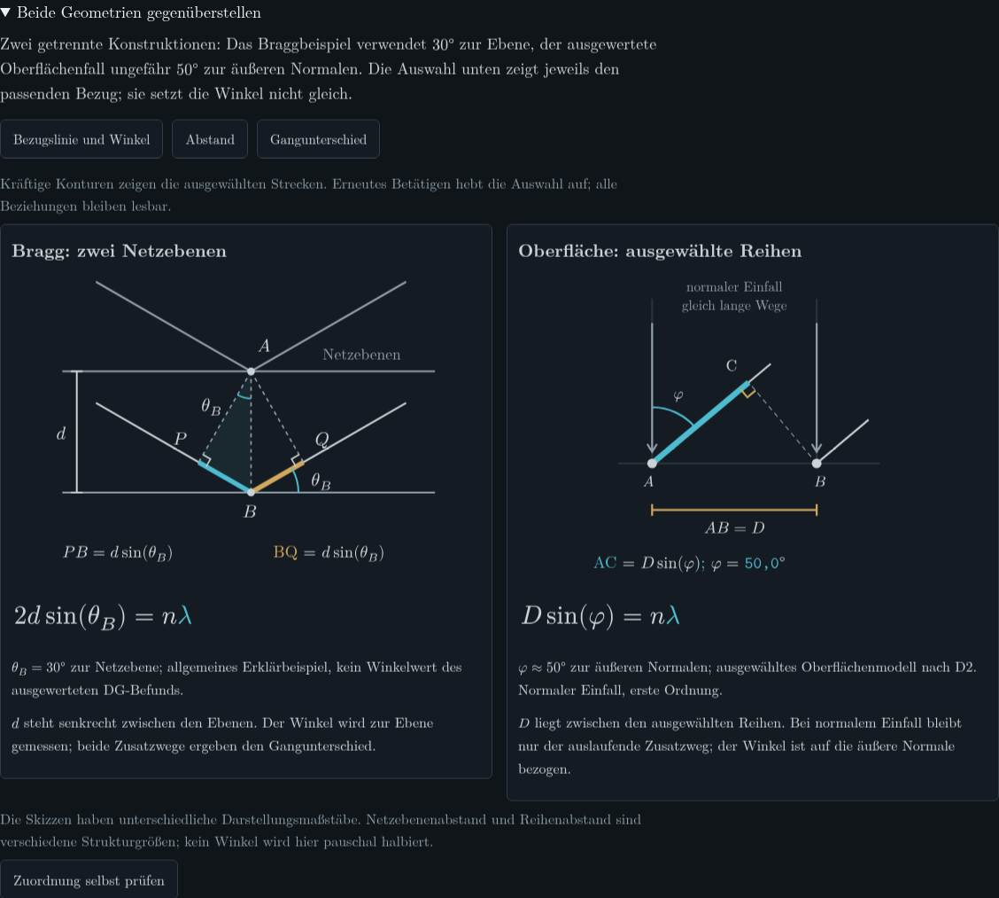
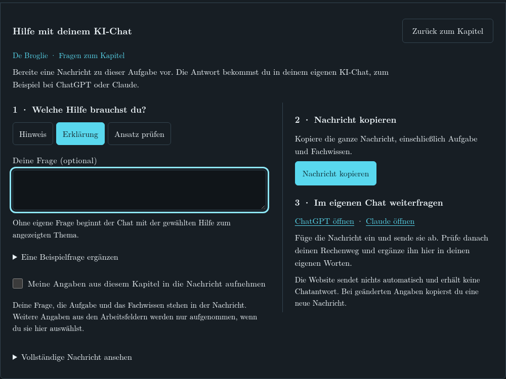

# Materiewellen

**Wie lässt sich zeigen, dass Elektronen eine Wellenlänge besitzen?**

Eine interaktive Physikarbeit für den Leistungskurs. Von de Broglies Vorhersage
über die Beugung am Nickelkristall bis zu Jönssons Doppelspaltversuch: Modelle
verändern, Rechnungen nachvollziehen und am historischen Bild selbst messen.
Ein dreiseitiges Handout fasst den fachlichen Zusammenhang zusammen.

[Website öffnen](https://materiewelle.vercel.app/) · [Handout ansehen](docs/handout.pdf) · [QR-Code drucken](docs/website-qr-a4.pdf) · [Lokal starten](docs/START.md)

Die Website ist mit **Kotlin/JS und Kobweb** entwickelt. **Typst** setzt die
Formeln und das Handout.



*Zwei Geometrien mit unterschiedlichen Winkelbezügen: Bragg-Ebenen und Oberflächenreihen. Die Abbildung erklärt, weshalb der Detektorwinkel nicht einfach als Bragg-Winkel eingesetzt werden darf. Aufnahme aus dem lokalen Chromium-Prüflauf.*

## Die fachliche Idee

**De Broglie:** Aus Impuls und Beschleunigungsspannung entsteht eine überprüfbare
Vorhersage. Die Herleitung folgt dem eigenen Scrolltempo; vorherige Schritte
bleiben sichtbar.

**Davisson–Germer:** Der Kristall bietet eine unabhängige Strukturgröße. Zwei
Rechenwege werden verglichen; Bragg-Winkel und Detektorwinkel bleiben ausdrücklich
verschieden. Eine kleine rechnerische Differenz ersetzt keine Fehleranalyse.

**Jönsson:** Eine historische Aufnahme ermöglicht eine selbst gewählte
Bildauswertung. Messmarken arbeiten in Originalpixeln, unabhängig vom Zoom.
Referenzmarken, eigene Auswahl und Modellrechnung sind getrennt. Ohne belegten
Bildmaßstab ergibt sich daraus keine absolute Wellenlänge.

**Fazit:** Die Beobachtungen verbinden, die Grenzen benennen und die eigene
Schlussfolgerung formulieren. Für Fragen kann Kontext als Text in einen eigenen
KI-Chat kopiert werden; die Website selbst ruft kein Sprachmodell auf.

Bei der **KI-Hilfe** wählst du, ob dein eigener Chat einen Hinweis geben, etwas
erklären oder deinen Ansatz besprechen soll. Die Website bereitet die Nachricht
mit dem passenden Physikkontext vor: kopieren,
im eigenen Chat einfügen und dort absenden. Eigene Antworten und Messwerte werden
nur nach Auswahl ergänzt. Anschließend geht die Arbeit im Lernpfad weiter.



*Tutoroberfläche im Querformat, aufgenommen in Chromium bei 1080 × 810 Pixeln.*

## Zwei Blicke in den Quelltext

**Kotlin: vom Eingabefeld zum physikalischen Vergleich.**
[DgModelVariation.kt öffnen](apps/web/site/src/jsMain/kotlin/materiewelle/course/DgModelVariation.kt#L16).
`Voltage` und `SurfaceNormalAngle` machen die Bedeutung der Eingaben sichtbar.
Die beiden Rechnungen speisen direkt die Compose-for-Web-Oberfläche im
Kobweb-Projekt. Während einer ungültigen Eingabe bleiben die letzten gültigen
Ergebnisse erhalten; die Oberfläche erklärt das Problem.

**Typst: eine lesbare Herleitung wird zum gesetzten Dokument.**
[handout.typ öffnen](content/typst/handout.typ#L51-L73).
Text, Gleichungen und gezielte Hervorhebungen stehen gemeinsam in einer
editierbaren Quelle; Kontrollwerte werden beim Satz berechnet. Die Website nutzt
zusätzlich separat erzeugte Typst-SVGs: scharfe Formeln in Hell und Dunkel, ohne
einen Typst-Compiler im Browser.

## Warum Kotlin und Kobweb?

Kotlin verbindet hier Physikberechnungen, Zustand, Oberfläche und Styles.
Eigene Typen wie `Voltage` und `BraggPlaneAngle` helfen, Größen und Winkelbezüge
auseinanderzuhalten. Kobweb und Compose for Web machen daraus eine Oberfläche
mit normalen HTML-Bedienelementen; der Physikkern lässt sich unabhängig davon testen.

Kotlin ist eine eigenständige Sprache und auf der JVM für die Zusammenarbeit
mit Java ausgelegt. Diese Website nutzt **Kotlin/JS** und läuft als JavaScript im
Browser, ohne Java-Installation bei den Besuchern. Typst liefert die Formeln als
SVG und das Handout als PDF. Der Browser braucht dafür keinen Typst-Compiler.
Typen ersetzen keine fachliche Prüfung. Die [Architekturübersicht](docs/TECHNIK.md)
erklärt Datenfluss, Werkzeuge und Grenzen genauer.

## Wie das Projekt entstanden ist

Aus mehreren Format- und Technikproben wurden vier zusammenhängende Kapitel,
eine Weboberfläche und ein kurzes Handout. Rückmeldungen veränderten die Gestaltung:
Herleitungen folgen dem Lesen, Vergleiche zeigen ihre Ergebnisse direkt und der
Tutor arbeitet mit kopierbarem Kontext.

KI-Agenten unterstützten Entwürfe, Implementierung und Gegenprüfungen. Ziel- und
Gestaltungsentscheidungen, tatsächlich eigene Rechnungen und Messbegründungen
werden davon getrennt dokumentiert. Automatisierte Tests und Agentenreviews sind
keine persönlichen Fachprüfungen und kein Nachweis des Lernerfolgs.

[Entstehung und Arbeitsweise](docs/ENTSTEHUNG.md) · [Beispiel einer Fehlerdiagnose mit Korrektur](docs/ENTSTEHUNG.md#ein-fehler-und-seine-korrektur)

Für das Handout stehen zwei neue Vorschauen zur Auswahl:
[Variante A](docs/handout-varianten/A.pdf) · [Variante B](docs/handout-varianten/B.pdf) ·
[Seitenvorschauen und Unterschiede](docs/handout-varianten/README.md).
Das oben verlinkte Handout bleibt bis zur Auswahl die bisherige Fassung.

## Orientierung

```text
apps/web/                 Kobweb-Oberfläche und Browserprüfungen
packages/physics-core/    Größen, Rechnungen, Zustände und Fachtests
content/                 Typst, Versuchsdaten, Messprofil und Tutor
tools/                  Reproduzierbarer Build und Paketierung
docs/                   Technik, Entstehung, Quellen und Prüfstand
archive/                Frühere UI-Entwürfe und abgeschaltete Workflows
```

[Architektur](docs/TECHNIK.md) · [Quellen und Modellgrenzen](docs/QUELLEN.md) · [Prüfstand](docs/PRUEFSTAND.md)

Zielgeräte sind Laptop und iPad im Querformat. Die vorhandenen automatisierten
Prüfungen verwenden Chromium; eine echte iPad-/Safari-Probe und die öffentliche
Deploymentrevision werden separat bestätigt. Die Anwendung ist eine clientseitig
gerenderte statische Website auf Vercel. GitHub Actions sind abgeschaltet;
Build und Browserprüfungen lassen sich lokal ausführen.

Eigener Programmcode: [MIT](LICENSE). Texte, historische Aufnahme, Schriften und weitere Fremdmaterialien: [gesonderte Hinweise](THIRD-PARTY-NOTICES.md).
