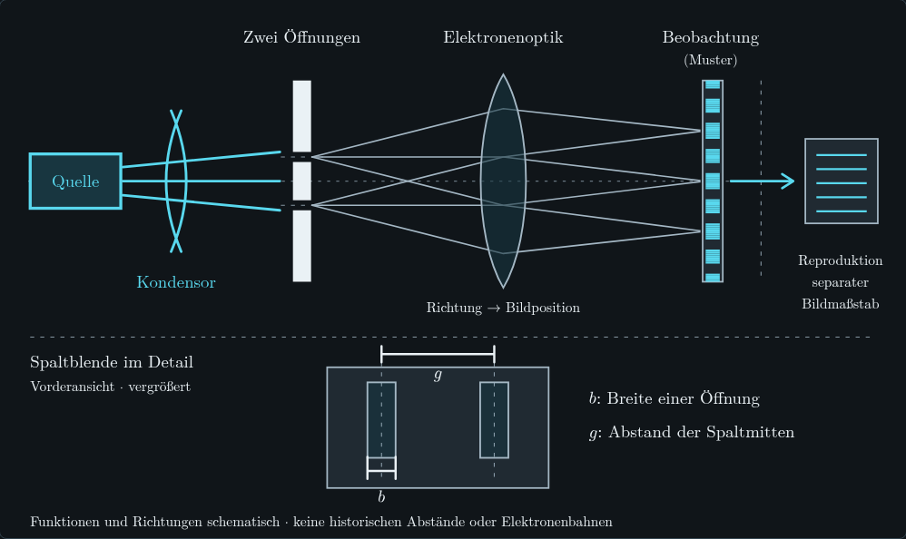

> Historischer Prüfstand vor der aktuellen Überarbeitung. Maßgeblich ist [docs/PRUEFSTAND.md](../../docs/PRUEFSTAND.md).

# Prüfstand

## Abschlussänderungen · 10. November 2026

Beim Jönsson-Aufbau führt **„Erklärung lesen“** zur aktuellen Erläuterung unter
der Kopfzeile. Weiter und Zurück bleiben an derselben Stelle und lösen keinen
Lesesprung aus. **„Erste Auswahl festhalten“**, **„Stand als A merken“** und
**„Stand A löschen“** unterscheiden die Messaktionen. Die Vorhersageanweisung
nennt den aufklappbaren Bereich. Handout **v1.7**, README und Gesprächsvorbereitung
ordnen Besucherübungen und die persönliche Vorstellung des Autors klar zu.

| Tatsächlich ausgeführte Prüfung | Ergebnis |
|---|---|
| Produktionsbuild und Quellbindung | Statische SPA neu gebaut; 331 Produktinputs stimmen, alle 1.405 Exportdateien geprüft. |
| Kotlin/JS | 160 Website- und 5 Browserdesign-Tests bestanden, keine Fehler oder übersprungenen Tests. |
| Handout | 11 Tests bestanden; drei A4-Seiten, keine Typst-Warnungen; alle Seiten visuell geprüft. Der tatsächliche Browserdownload ist bytegleich mit [handout.pdf](../../docs/handout.pdf). |
| Vollständige Browsermatrix | Alle sechs Suiten in einem gemeinsamen Durchlauf bestanden: 28 Szenarien, 1.760 Assertions, 168 Screenshots. |
| Gezielte Bedienprüfung | 36 zusätzliche Checks und 20 Screenshots bei 1080×810 und 1024×700 mit synthetischem Touch, beide Themes; keine Konsolen- oder Seitenfehler. |
| UI-Vertrag | 109 Featuredateien gegen 14 Regeln geprüft. |

Die erweiterte Browserregression prüft den bewussten Erklärsprung, sichtbaren
Tastaturfokus, alle vier Aufbauschritte vorwärts und rückwärts, normalen und
reduzierten Bewegungsmodus sowie Laptop- und Tabletgrößen. Die bestehenden
Mess-, Tutor-, Speicher-, Fehlerfall- und Downloadprüfungen sind Teil derselben
Matrix. Ein unabhängiger Textreview fand keine weiteren Blocker.

*1080×810, lokales Chromium; „Erklärung lesen“ zeigt den Text auf bewusste
Anforderung vollständig. Der Klick auf Weiter verändert nur den Aufbauschritt.*

Die [maschinenlesbaren Nachweise](../../docs/pruefstand.json) stehen unter
`latest_change_verification`; frühere Runden sind historisch eingeordnet.
Originalberichte, Manifest und weitere Screenshots liegen im lokalen Paket
`final-implementation-2026-11-10`.

**Offene Übergabepunkte:** Der geprüfte [GitHub-Lauf](https://github.com/crazjj/materiewelle/actions/runs/42702770433)
startete wegen einer Billing-Kontosperre nicht. Eine bestätigte Vercel-Liverevision
und ein echter iPad-9-/Safari-Test stehen aus; der Umgebungsproxy blockiert den
Hostzugriff. Die öffentliche Nutzungsgrundlage der historischen Foto-Reproduktion
bleibt gesondert zu klären. Der Hinweis auf die damalige Übersetzungserlaubnis in
J1 ist keine dokumentierte allgemeine Freigabe für dieses Projekt.
Screenreader, externe KI-Antworten und menschlicher Lernerfolg wurden nicht geprüft.
Ein neuer Unterpfad-Export gehört nicht zu dieser Abschlussrunde.

## Frühere Umsetzung des Abschlussreviews · 9. November 2026

Der damalige Root-Export enthielt die überarbeiteten Messwerkzeuge, den
sichtbaren DG-Geometrievergleich, die Tutorvorschau und Handout v1.6. Seine
**331 Produktinputs** stimmten mit den damals aktuellen Produktquellen überein;
alle 1.405 Exportdateien wurden gegen ihr Manifest geprüft.

| Prüfung | Ergebnis |
|---|---|
| Kotlin/JS | Website: 160 Tests; Browserdesign: 5 Tests. Keine Fehler oder übersprungenen Tests. |
| Handout | 11 Tests bestanden; drei A4-Seiten, eingebettete Schriften, keine Typst-Warnungen. Alle Seiten und geänderten Zeichnungen visuell geprüft. |
| Tutorpaket und UI-Vertrag | 6 Pakettests, 5 Regeltests und der Vertragscheck mit 109 Featuredateien und 14 Regeln bestanden. |
| Vollständige Browsermatrix | Alle sechs Suiten bestanden: 28 Szenarien, 1.654 Assertions, 160 Screenshots. |
| Zusätzliche Tutorprüfung | 44 Checks bei 1080×810 mit Touchsimulation und 1440×900 mit Maus; beide Themes, echte Zwischenablage und manueller Kopierweg. |
| PDF-Download | Der tatsächlich heruntergeladene Inhalt ist bytegleich mit [docs/handout.pdf](../../docs/handout.pdf). |

Geprüft wurden insbesondere native Bildkoordinaten, Zoomunabhängigkeit, der erst
nach Referenzöffnung angebotene Messhinweis, bewusstes Öffnen der Phasenvertiefung,
Fokus und Rückkehr aus dem Tutor, vollständige Textauswahl bei gesperrter
Zwischenablage sowie Schutz vor veralteten Kopierbestätigungen. Die letzte
De-Broglie-Erklärung färbt nur ihren Textbereich; die gesamte Formeltafel bleibt
sichtbar. Bestehende Ressourcenfehler- und Mehrtabprüfungen sind weiterhin Teil
der vollständigen Matrix.

Frühere Läufe fanden einen zu langen Einführungstext vor dem Jönsson-Bild sowie
unklare Kurzbezeichnungen in der Vergleichstabelle. Beides wurde korrigiert. Ein
Rückkehrtest wurde um den Fall einer während der Hilfe aufgeklappten Werkzeugleiste
ergänzt: Bei geänderter Dokumenthöhe zählt die ursprüngliche Bildschirmposition
des Einstiegsknopfs. Der bisherige Test für unverändertes Layout bleibt erhalten.
Auch die alten Text- und Reihenfolgeerwartungen der Jönsson- und Fazittests wurden
an die beabsichtigte Darstellung angepasst; beide Suiten wurden vollständig
wiederholt. Alle sechs vollständigen Originalberichte wurden einzeln gegen das
gleiche Exportmanifest und die aktuellen Prüfscripte validiert. Unveränderte,
bereits bestandene Suiten wurden dabei weiterverwendet. Fehlgeschlagene
Gruppenquittungen und Originalberichte bleiben erhalten. Dies ist kein
behaupteter erfolgreicher Erstlauf des Sammelrunners.

Die [maschinenlesbaren Nachweise](../../docs/pruefstand.json) dieser Runde stehen unter
`previous_change_verifications`.
Screenshots von Tutor und Herleitung in der Dokumentation stammen aus dem finalen
Export. Originalberichte und weitere Bilder liegen im lokalen Abnahmepaket
`review-implementation-2026-11-09`.

**Grenzen:** Dies ist eine lokale Chromium-Prüfung der statischen SPA. Reales
Safari/iPad 9, Screenreader, externe KI-Antworten und menschlicher Lernerfolg sind
nicht damit nachgewiesen. Unterpfad und Releasearchive wurden in dieser Runde
nicht neu erstellt. Der Vercel-Host war durch den Umgebungsproxy gesperrt;
daraus folgt kein Websitefehler und keine bestätigte Live-Revision. Die historische
Bildnutzungsgrundlage bleibt gesondert offen. Die bisherigen breiten Fachkern-
und Unterpfadtests unten sind historische Nachweise, keine neuen Ausführungen.

## Frühere Tutorüberarbeitung · 9. November 2026

Der damalige Root-Export wurde mit den überarbeiteten Tutor- und Speicherabläufen
neu gebaut. Seine **329 Produktinputs** stimmten mit den damals geprüften Quellen überein.

| Prüfung | Ergebnis |
|---|---|
| Kotlin/JS | Website: 153 Tests; Browserdesign: 5 Tests. Keine Fehler oder übersprungenen Tests. |
| Tutorpaket und UI-Vertrag | 6 Pakettests, 5 Regeltests und der UI-Vertragscheck erfolgreich. |
| Bestehende Browser-Suiten | Alle sechs Suiten vollständig bestanden: 28 Szenarien, 1.637 Assertions, 159 Screenshots. |
| Gezielte Tutorbedienung | 252 zusätzliche Checks über 1080×810 Touch, 1024×700 Touch und 1440×900 Maus; helle Ansicht zusätzlich geprüft. |
| Speicherung und Zurücksetzen | 12 zusätzliche Browserchecks für Spaltnotizen, Zweittab, Rücksetzen, Löschen und echte Schreibfehler bestanden. |
| Konsole | Zusätzlicher Durchgang durch vier Kapitel in drei Fenstergrößen ohne Fehler, Warnungen oder JavaScript-Seitenfehler. |

Die sechs Originalberichte wurden einzeln gegen die damaligen Prüfscripte und
dasselbe Exportmanifest validiert. Die ersten Sammelläufe stoppten an veralteten
Textassertionen; diese wurden korrigiert und die betroffenen Suiten vollständig
wiederholt. Die fehlgeschlagenen Originalberichte bleiben erhalten. Dies ist kein
behaupteter fehlerfreier Erstlauf des Sammelrunners.

Geprüft sind insbesondere der wiederholte Einstieg von der Startseite, sichtbarer
Fokus beim lokalen Öffnen, alle drei Hilfearten, tatsächliche Zwischenablage,
aufgabenbezogene A/B-Vergleiche, Spaltnotizen und die zusätzliche Freigabe früherer
Ergebnisse im Fazit. Die Speicherverwaltung ist geschlossen am Seitenende; echte
Schreibfehler behalten einen Rettungsweg. Ein Screenshot steht in der README.

Die [maschinenlesbaren Nachweise](../../docs/pruefstand.json) führen diese Runde unter
`previous_change_verifications`. Der Unterpfad-Export und die Release-ZIP-Dateien
wurden für diesen Tutorumbau nicht erneut gebaut oder geprüft. Die frühere breite
Abnahme unten ist dafür ein historischer Nachweis, kein Nachweis der aktuellen UI.
Vercel-Livestand, gehostete CI, echte iPads/Safari und Antworten externer KI-Dienste
sind durch diese lokalen Läufe nicht bestätigt.

## Vorherige breite Abnahme

**Frühere lokale Prüfung vom 9. November 2026, vor der Tutorüberarbeitung:** Beide statischen Exporte wurden nach
der Abschlussrunde zu Bedienung, Fachtexten und Handout neu gebaut und vollständig
nach der
[Browsermatrix](../../.github/scripts/BROWSER-CHECKS.md) geprüft. Die Zahlen stammen
aus den damaligen Läufen.

| Prüfung | Ergebnis |
|---|---|
| Kotlin | 528 Testausführungen: Physikkern JVM 202, Physikkern JS 191, Website JS 130, Browserdesign JS 5. Keine Fehler oder übersprungenen Tests. |
| Python | 134 gezählte Testfälle bestanden; alle 16 aufgerufenen Prüfskripte erfolgreich. Darunter ein zusätzlicher Assetcheck ohne eigene Testfallzählung. |
| Root-Export `/` | Alle sechs Suiten bestanden: 28 Szenarioausführungen, 1.615 Assertions, 159 Screenshots. |
| Projektpfad `/materiewelle/` | Alle drei vorgesehenen Suiten bestanden: 18 Szenarioausführungen, 1.227 Assertions, 110 Screenshots. |
| Handout | Drei Seiten; die tatsächlichen PDF-Downloads sind bytegleich mit [docs/handout.pdf](../../docs/handout.pdf). |
| QR-Druckvorlage | Unveränderte A4-Druckvorlage; Bytegleichheit und QR-Ziel wurden bereits in der vorherigen Abnahme vom selben Tag geprüft. Der QR-Code wurde aus der gerenderten PDF unabhängig zurückgelesen: `https://materiewelle.vercel.app/`. |

Die Browserläufe verwenden **Chromium 154.0.8037.57** unter Linux und synthetische
Eingaben. Root und Unterpfad wiederholen Teile derselben Szenarien; JVM und
JavaScript prüfen teilweise dieselbe Fachlogik. Die Zahlen sind keine Summe
unabhängiger Fachprüfungen oder Lernbewertungen.

## Gezielte Nachprüfungen

- Die de-Broglie-Markierung folgt der Leselinie unter der Kopfzeile, auch bei
  größeren Vor- und Rücksprüngen. Ruhemodus, Tastatur und Rückkehr aus der Übung
  sind einbezogen. Auch am sechsten Schritt bleibt die vollständige Formeltafel
  in 1080 × 810, 1024 × 700 und 1440 × 900 sichtbar; die anschließende Aufgabe
  wird nicht überdeckt.
- Bei Davisson–Germer bleibt der Knopf für Bildschritte an seiner Position.
  Am Ende von Aufbau und Bragg-Erklärung ist der nächste Abschnitt erreichbar.
  Die Erklärung läuft ohne eigenen inneren Scrollbereich im Dokument weiter.
  Die Darstellung wurde auch bei 1080 × 810 und 1024 × 700 geprüft.
- Persönliche Ergebnisse stammen aus den Eingaben und Messungen des jeweiligen
  Besuchers. Eine unbenutzte freiwillige Belegtabelle erscheint nicht im Bericht.
  Teilangaben bleiben mit ihrem Wortlaut und ihrer Zeilennummer erhalten — in
  der Darstellung, der tatsächlichen Zwischenablage und der heruntergeladenen
  Textdatei. Vorhandene gespeicherte Daten werden nicht umgeschrieben.
- Die Eingabevorschau entfernt überflüssige Nullen. Validierung und gespeicherte
  Werte bleiben ungerundet; die Vorschau verändert keine Toleranzgrenze.
- Der Zweittab erlaubt Erklärschritte, Quellen, Kontrollrechnung und Tutorhilfe.
  Persönliche Eingaben bleiben geschützt. Der Test überwacht die tatsächlichen
  Speicheraufrufe und verlangt unveränderte Antworten, Entwürfe und Leseposition.
  Eine lokale Referenzansicht wird nicht in den Messzustand geschrieben.
- Eine neue Sitzung besitzt keine vermeintlich selbst gemerkte Vergleichsspannung.
  Bewusst gespeicherte Werte bleiben bei Änderungen und nach Neuladen erhalten;
  vorhandene explizite Werte gehen auch beim Lesen älterer Stände nicht verloren.
- Die DG-Formelzeilen trennen Aussagen mit Semikola. Die Azimutbeschriftung hält
  in beiden Themes Abstand zu den tatsächlich gerenderten Punkten und Reihen.
- Das Spaltmodell erklärt beide Änderungsrichtungen von Spaltabstand und Breite.
  Die Browserprüfung vergleicht diese Rückmeldung mit den gewählten Parametern.
- Alle drei Handoutseiten wurden in Farbe und Graustufen angesehen. Definitionen,
  Zusatzwege und Einheitensatz sind ergänzt; beide Exporte enthalten dasselbe PDF.

Die übrigen Suiten prüfen unter anderem DG-Geometrien, native Bildkoordinaten,
Messvergleiche, Tutor-Kontext und Fokus, lokale Speicherung, Mehrtabkonflikte,
Ressourcenfehler und PDF-Downloads. Ausgewählte Screenshots der geänderten
Ansichten wurden zusätzlich visuell geprüft.

## Zuordnung der Nachweise

Die [maschinenlesbare Zusammenfassung](../../docs/pruefstand.json) enthält die Zählung je
Suite sowie SHA-256 der Berichte und Exportmanifeste. Beide Exporte verwenden
dieselben **328 Produktinputs**; deren Hashes stimmten mit den damals geprüften
Produktquellen überein. Berichte und Prüfscripte sind durch die Gruppenbelege
verbunden, alle ausgelieferten Dateien wurden gegen ihre Manifeste geprüft.

Vollständige Originalberichte und Screenshots bleiben im lokalen Abnahmepaket.
[START.md](../../docs/START.md) beschreibt die reproduzierbaren Aufrufe. Die Git-Datierung
des zusammengefassten Commits ersetzt diese tatsächlichen Prüfzeitpunkte nicht.

Die beiden Release-ZIP-Dateien wurden außerdem tatsächlich entpackt und in
Chromium geöffnet: vier Kapitel, eigene native Messmarken, Tutor-Nachricht und
PDF-Download bestanden. Dateiinventar und Prüfsummen stimmen mit den zuvor
vollständig geprüften Exporten überein.

## Grenzen dieser Prüfung

Ein lokaler Build oder Git-Push bestätigt keine öffentliche Vercel-Revision.
Der zuletzt eingesehene GitHub-Actions-Lauf startete wegen einer von GitHub
gemeldeten Kontosperre aufgrund eines Abrechnungsproblems nicht. Die lokale
Prüfung ist deshalb ausdrücklich kein Nachweis einer erfolgreichen gehosteten CI.

Reales iPad 9/Safari, echte Touchhardware, Screenreader, menschlicher Lernerfolg
und persönliche fachliche Bearbeitung sind durch diese Automatisierung nicht
bestätigt. Die [Nutzungsgrundlage der historischen Aufnahme](../../docs/QUELLEN.md) bleibt
gesondert zu klären; lokale Prüfungen erteilen keine Medienrechte.
