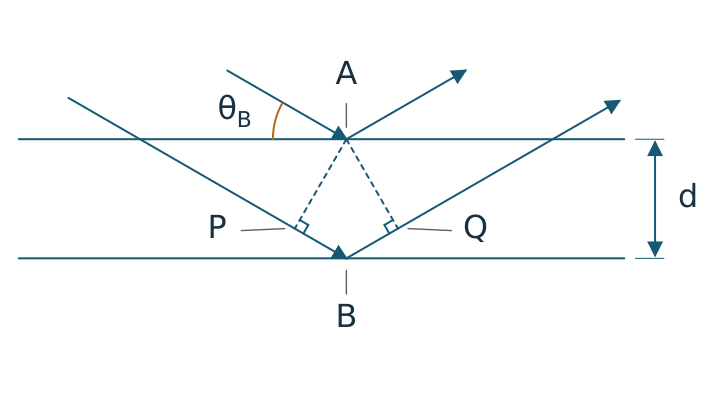

# Entstehung und Arbeitsweise

Dieses Repository ist die kuratierte Fassung einer über mehrere Entwürfe
entwickelten Physikarbeit. Der vollständige frühere Verlauf ist zusätzlich privat
gesichert. Frühere Commits können über alte GitHub-Verweise weiterhin erreichbar
sein; eine Zusammenfassung des Hauptbranches löscht diese Verweise nicht.
Die folgende Chronik beschreibt reale Entscheidungen und Änderungen; sie ist
keine nachträglich erfundene Reihe von Entwicklungscommits.

## Entscheidungen im Projekt

| Ausgangspunkt | Entscheidung und Umsetzung | Was daran nachvollziehbar ist |
|---|---|---|
| Mehrere Formate und eine zweite App wurden erprobt. | Konzentration auf Kobweb, vier zusammenhängende Kapitel und ein dreiseitiges Handout. | Der Projektinhaber legte den Umfang und die technische Richtung im Austausch fest. Frühere Proben bleiben im Arbeitsarchiv. |
| Zeitgesteuerte Formelschritte störten den Lesefluss. | Vorherige Schritte bleiben stehen; die Markierung folgt dem eigenen Scrollen. | Konkrete Bedienrückmeldungen führten zu Änderungen und passenden Browserregressionen. |
| Ein Bild kann unabhängig vom Zoom unterschiedlich groß erscheinen. | Marken und Profil arbeiten in nativen Pixeln; eigene Auswahl und dokumentierte Referenz sind getrennt. | Die technische Entscheidung folgt der Messmethodik. Ohne Maßstab wird keine absolute Wellenlänge behauptet. |
| Tutorhilfe war durch Downloads und technische Hinweise unklar. | Lesbare Kopiernachricht mit Frage, Fachkontext und bewusst freigegebenen eigenen Angaben. | Kein Live-Backend oder Modellzugang auf der Website nötig. |
| Buchstaben im Handout lagen an Strahlen. | Beschriftungen freigestellt, Lotmarken ergänzt und PDF-Geometrie auf Abstand geprüft. | Die erste Sichtprüfung hatte den Fehler übersehen. Die Korrektur wurde am erzeugten PDF und echten Download nachgeprüft. |

Für die Texte gelten kurze [sprachliche Leitlinien](SPRACHE.md): konkrete
Handlungen, erklärte Fachbegriffe und eine klare Trennung von Quellen, Modellen
und eigenen Angaben.

## Letzte Konsolidierung

Der Hauptpfad bleibt auf die Vorhersage und die beiden Experimente konzentriert.
Zusätzliche Phasen- und Trefferansichten stehen am Kapitelende. Bild und Profil
sind beim Messen gemeinsam sichtbar; der zusätzliche Vergleich zweier eigener
Auswahlen bleibt aufklappbar. Arbeitsbericht und Gerätekopie verwenden dieselben
verfügbaren Quellenangaben, technische Anhänge sind freiwillig.

Die beiden neuen [Handoutfassungen](handout-varianten/README.md) sind Vorschauen,
keine stillschweigende Auswahl. Frühere, nicht mehr aufgerufene UI-Proben und die
abgeschalteten GitHub-Workflows sind im [Archiv](../archive/README.md) erhalten.

## Ein Fehler und seine Korrektur

Beim Tutor konnte ein verspätet geladener Fachtext den Cursor aus einer begonnenen
Rechennotiz zurück ins Fragefeld versetzen. Ein protokollierter Browserlauf zeigte,
dass die Eingabe bereits im neuen Dokument stattfand: Es war ein Fokusfehler,
kein Zurücksetzen des gespeicherten Stands.

Der Fokus wird jetzt nur beim bewussten Öffnen gesetzt. Ein Regressionstest hält
den echten Fachtextabruf zurück, wechselt nach einer Frage zum Rechenweg und gibt
die Antwort erst danach frei. Frage, Notiz und Fokus müssen erhalten bleiben.
Der bestehende Mehrtabtest wurde dabei nicht abgeschwächt. Der aktuelle Test liegt
in [test-run-two.py](../apps/web/scripts/test-run-two.py); der private Ausgangsverlauf
bewahrt Originaltrace und vorherigen Fehlerbericht.

Im abschließenden Review blockierte der Schreibschutz eines zweiten Tabs auch
Erklärschritte und Tutorhilfe. Jetzt schützen die einzelnen Eingabefelder und
die Zustandslogik persönliche Antworten und Messungen; reine Leseaktionen bleiben
bedienbar. Der Browsertest öffnet dafür zwei Tabs und prüft neben der Bedienung,
dass der Lesetab weder Antworten noch Notizen oder die gespeicherte Leseposition
überschreibt. Das Schließen des ersten Tabs erlaubt keine automatische Übernahme
eines veralteten Stands.

## KI-Unterstützung und persönlicher Anteil

Entwürfe, große Teile der Implementierung und automatisierte Gegenprüfungen
entstanden mit KI-Agenten. Der Projektinhaber bestimmte Zielrichtung, Umfang und
Gestaltung durch konkrete Rückmeldungen. Eigene Rechnungen, Bildentscheidungen,
Quellenprüfungen und das Verständnis für das Fachgespräch sind davon getrennte
Leistungen. Die Anwendung stellt dafür Arbeitsfelder und einen lesbaren Bericht
bereit; sie trägt keine persönlichen Fachleistungen stellvertretend ein.

Agentenrollen sind keine realen Lehrkräfte oder Lernenden. Tests belegen die
geprüften technischen Eigenschaften, nicht automatisch Lernerfolg oder eine
persönliche Quellenlektüre. Die tatsächlichen Grenzen stehen im [Prüfstand](PRUEFSTAND.md).

## Zusammengefasste Git-Historie

Die aufbereitete Fassung wurde am **9. November 2026** zusammengestellt und bis
zum **10. November 2026** weiter geprüft und korrigiert. Der Hauptbranch enthält
einen zusammengefassten Übergabecommit mit dem tatsächlichen Datum dieser
Zusammenfassung. Der vorherige Verlauf ist außerhalb des öffentlichen
Repositories gesichert; die fachlichen Nachweise und tatsächlichen Prüfzeitpunkte
bleiben erhalten.

Eine frühere, archivierte Zwischenfassung hatte ein auf den 6. November 2026,
12:50 Uhr Europe/Berlin gesetztes Gitdatum. Dieses gewählte Metadatum belegt
keine frühere Fertigstellung. Die aktuelle Zusammenfassung ist nicht rückdatiert.
Alte GitHub-Commit- und Actions-Verweise können weiterhin erreichbar sein.
