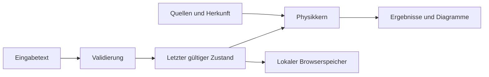
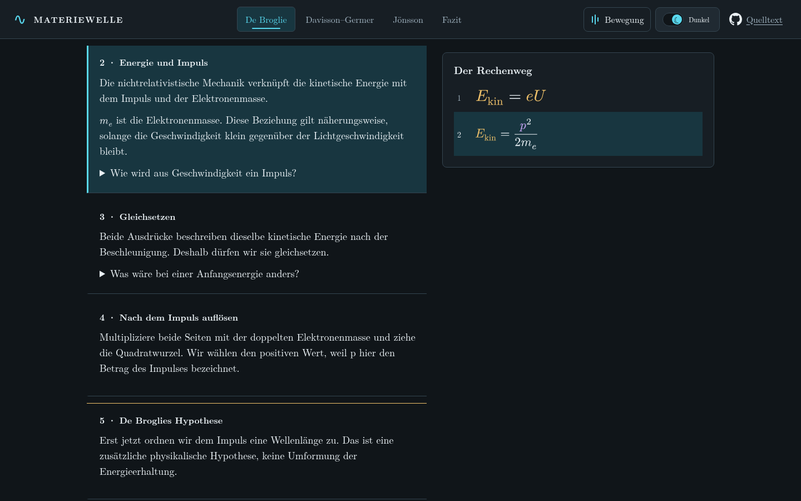

# Technik und Entscheidungen

Die Anwendung ist eine statische, im Browser gerenderte DOM-Website. Kobweb
organisiert das Kotlin/JS-Projekt; Compose for Web beschreibt die Oberfläche,
Silk liefert die Theme-Grundlage. Es gibt keinen Server für Konten, Sitzungen oder
KI-Anfragen. Zwei Quellenbeispiele sind direkt in der [README](../README.md) erklärt.

## Datenfluss

`Voltage`, `SurfaceNormalAngle`, Längen und native Pixelkoordinaten benennen
unterschiedliche Größen. Der bearbeitete Text bleibt auch bei einer unvollständigen
Eingabe sichtbar; gerechnet wird mit dem letzten gültigen Wert. Ladezustände sind
explizit modelliert. Die Fachlogik im [Physikkern](../packages/physics-core/) benötigt
kein DOM und wird auf JVM sowie JavaScript geprüft.

## Automatisches Speichern

Antworten, Messungen, Tutorfragen und die Vorhersagen und Begründungen beider
Spaltuntersuchungen werden im Hintergrund in diesem Browser gespeichert. Die
geschlossene Verwaltung „Arbeit auf diesem Gerät“ steht unter dem Lerninhalt.
Eine Textkopie dient zum Lesen und Weitergeben; sie ist keine Wiederherstellungsdatei.
Erst ein tatsächlicher Speicher- oder Datenfehler zeigt oben einen direkten
Rettungsweg für die noch im Tab vorhandenen Texte.

Genau ein Tab besitzt die Schreibsitzung. Weitere Tabs erlauben das Lesen und die
Tutorhilfe, verändern aber den gespeicherten Stand nicht. Das Schließen des ersten
Tabs überträgt die Schreibberechtigung nicht auf eine veraltete Ansicht. Die
Verwaltung bietet stattdessen „Hier weiterarbeiten“ an: Nach dem Schließen des
anderen Tabs wird der aktuelle Stand neu geladen. Wurde im Lesetab eine eigene
Tutorfrage verändert, fragt dieser Schritt zusätzlich nach. Spaltnotizen sind dort
wie andere persönliche Arbeitsfelder schreibgeschützt; reine Ansichtsänderungen
brauchen keine Bestätigung.

Die Löschfunktion entfernt nur die vorgesehenen Projekteinträge. Bis zum bewussten
Neuladen bleibt das Speichern angehalten, damit alte Komponenten gelöschte Angaben
nicht wiederherstellen. Neue Arbeit in diesem Zeitraum erhält wieder einen
Rettungshinweis. Beschädigte oder zwischenzeitlich extern geänderte Einträge bleiben
geschützt. Das ergänzte Feld für Spaltnotizen ist optional; ältere Ansichtsstände
werden mit leeren Spaltnotizen gelesen. Eingabe- und Gesamtgrößengrenzen gelten
beim Lesen und Schreiben.

## Aufgabenbezogene KI-Hilfe

Die Oberfläche unterscheidet Kapitelhilfe, feste Rechenaufgaben, freie Modelle und
Bildmessung. Typisierte Projektionen stellen die jeweils passenden Angaben
zusammen: etwa zwei Modelleinstellungen mit Einheiten oder native Bildmarken mit
Auswahlbegründung. Die Vorschau zeigt diese Angaben vor dem Kopieren. Im Fazit
erfordert die Übernahme früherer Kapitel eine eigene zusätzliche Auswahl.

Die gewählte Hilfeart und die aktuelle Frage stehen vor den freigegebenen Angaben
und der fachlichen Grundlage. Paketinhalte werden anhand ihres Manifests und ihrer
SHA-256-Prüfsumme geprüft. Die Website sendet keine Anfrage an einen KI-Anbieter;
der Nutzer fügt den Text in seinen eigenen Chat ein. Bilder und spätere Änderungen
werden nicht automatisch übertragen. Antwort und Folgefragen bleiben im externen
Chat, während die eigene Bearbeitung auf der Website fortgesetzt wird.

## Warum diese Aufteilung?

| Entscheidung | Grund | Grenze |
|---|---|---|
| Kobweb und Kotlin/JS | Zustände, Komponenten, Styles und Fachmodelle in einer Sprache; native Browserbedienung. | Build- und Prüfwerkzeuge verwenden weiterhin Python/Shell. Kotlin ersetzt keine fachliche Prüfung. |
| Getrennter Physikkern | Rechnungen unabhängig von Darstellung prüfen; Einheiten-/Winkelverwechslungen erschweren. | UI-Tests bleiben für Bedienung und Darstellung nötig. |
| Typst vor dem Webbuild | Formeln als transparente SVGs für beide Themes, reproduzierbares dreiseitiges PDF. | Kein interaktiver Typst-Compiler im Browser; Änderungen benötigen einen Build. |
| Originalpixel für die Bildmessung | Zoom und CSS-Größe verändern keine Abstände. | Ohne belegte Kalibrierung keine absolute Wellenlänge aus dem Bild. |
| Kopierbarer Tutor-Kontext | Eigener Chat ohne API-Schlüssel oder Backend; eigene Angaben nur nach Auswahl. | Antworten des gewählten Sprachmodells bleiben extern und müssen geprüft werden. |
| Statische Auslieferung | Dateien können lokal oder auf Vercel bereitgestellt werden. | Kein geräteübergreifendes Speichern; kein Prerendering-Nachweis. |

## Module und Build

`apps/web/site` enthält Artikel und Interaktionen. `browser-design` erzeugt die
Styles aus Kotlin, `browser-bootstrap` setzt das gewählte Theme früh beim Laden.
`packages/physics-core` enthält Datenmodelle, Berechnungen und Zustandsregeln.
Generatoren erzeugen Datenpaket, Bildprofil, SVG-Formeln, Handout und Tutortexte.
Die exportierten Dateien werden über eine Positivliste und SHA-256 geprüft.

Der Build und die lokalen Prüfungen sind in [START.md](START.md) beschrieben.
GitHub Actions sind abgeschaltet; frühere Workflow-Dateien liegen unter
`archive/github-actions/`. Nicht mehr verwendete UI-Proben sind unter
`archive/previous-ui/` erhalten und werden nicht kompiliert. Der aktuelle
Lernpfad hat einen Einstieg und vier Kapitel; das Archiv ist keine zweite Anwendung.

Lesbare Arbeitsberichte und die Gerätekopie verwenden dieselbe fachliche
Projektion. Wenn die Quelldaten fehlen, bleibt eine als unvollständig bezeichnete
Rettungskopie möglich. Technische Rohdaten und Prüfvermerke werden nur auf
ausdrückliche Auswahl angehängt. Die gespeicherten Zahlen selbst bleiben präzise;
lesbare Texte runden sie passend zur Aussage.

SVG-Beschriftungen werden nach dem Einfügen und dem Laden der lokalen Schriften
vermessen. Weitere Änderungen der Textgröße lösen gezielte Neuberechnungen aus.
Dadurch berücksichtigen benachbarte Typst-Formeln auch vergrößerte
Wort- und Buchstabenabstände. Es gibt keine laufende Messschleife pro Animationsframe.

Quelländerungen, erzeugte Ausgaben und tatsächliche Browsernachweise bleiben
getrennt. Ein Git-Push allein belegt kein Vercel-Deployment. Der [Prüfstand](PRUEFSTAND.md)
nennt die ausgeführten Prüfungen und verbleibenden Grenzen.
