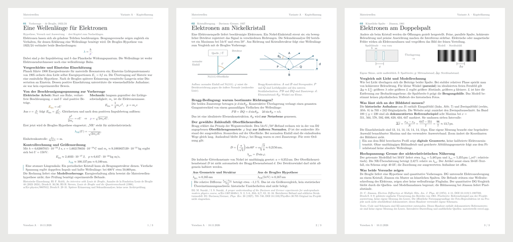
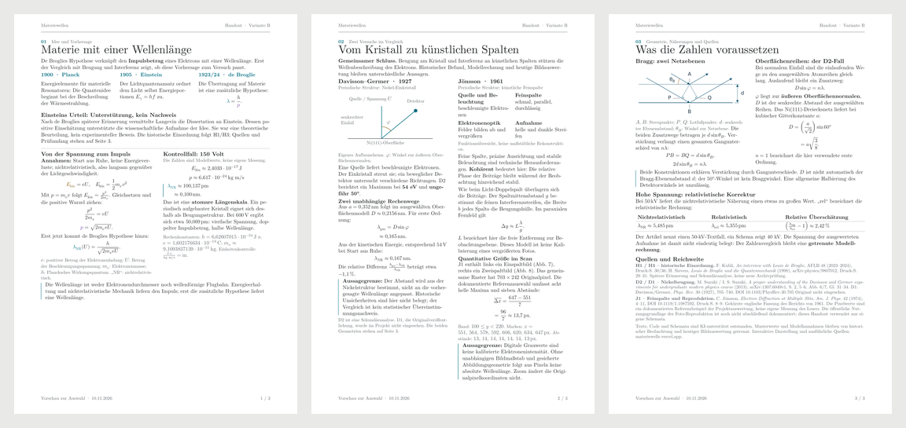

# Zwei Handoutvarianten zur Auswahl

Beide Vorschauen haben drei A4-Seiten, dieselben fachlichen Kernaussagen und Kontrollwerte sowie die bisherigen Schriften **Latin Modern Roman / Latin Modern Math**. Das [bisherige Handout](../handout.pdf) bleibt unverändert. Eine kanonische Variante ist noch nicht ausgewählt.

| | A · Kapitelfassung | B · Vergleichsfassung |
|---|---|---|
| PDF | [A.pdf](A.pdf) | [B.pdf](B.pdf) |
| Gliederung | De Broglie → Davisson–Germer → Jönsson: ein Kapitel je Seite | Idee und Vorhersage → beide Versuche im Vergleich → Geometrie, Näherungen und Quellen |
| Schwerpunkt | Vertraute Lesefolge, Herleitungen direkt beim jeweiligen Versuch | Gemeinsame Aussage und Unterschiede der Versuche leichter gegenüberstellen |
| Abwägung | Jönsson, relativistische Korrektur und Fazit teilen sich die dritte Seite | Die Vergleichsseite ist dichter; ausführliche Geometrie und Quellen stehen auf Seite 3 |
| Quelle | [A.typ](../../content/typst/varianten/A.typ) | [B.typ](../../content/typst/varianten/B.typ) |

Die Überarbeitung trennt Modellvorhersage, historische Aussage und heutige Bildauswertung. Beide Fassungen erhalten insbesondere die zwei DG-Geometrien, den Pixelabstand als Bildgröße, die fehlende absolute Kalibrierung und den getrennten relativistischen Modellfall. Sie enthalten keine persönlichen Vortragsaufgaben.

## Vorschau A

[](A.pdf)

Einzelseiten: [1](A-seite-1.png) · [2](A-seite-2.png) · [3](A-seite-3.png)

## Vorschau B

[](B.pdf)

Einzelseiten: [1](B-seite-1.png) · [2](B-seite-2.png) · [3](B-seite-3.png)

## Reproduzieren

Im Repository-Stamm mit Python, den [festgelegten Abhängigkeiten](../../content/typst/varianten/requirements.txt) und Poppler (`pdfinfo`, `pdffonts`, `pdftotext`, `pdftoppm`):

```sh
python -m pip install -r content/typst/varianten/requirements.txt
python content/typst/varianten/build.py
```

In der eingerichteten Arbeitsumgebung reicht:

```sh
/workspace/.materiewelle-tools/typst/bin/python content/typst/varianten/build.py
```

Der [isolierte Builder](../../content/typst/varianten/build.py) erzeugt PDFs, Seitenbilder und Übersichten nur im Vorschauordner. Er prüft drei A4-Seiten, eingebettete Schriften, zentrale Zahlen, Text innerhalb der Seiten und bytegleiche PDF-Wiederholungsbuilds. Hashes der Eingaben und Prüfergebnisse stehen im [Manifest](manifest.json). Die kanonische Handoutquelle und das bisherige PDF werden auf unveränderte Hashes geprüft; die Vorschauquellen gehören nicht zu den Eingaben des Produktionsbuilds.
